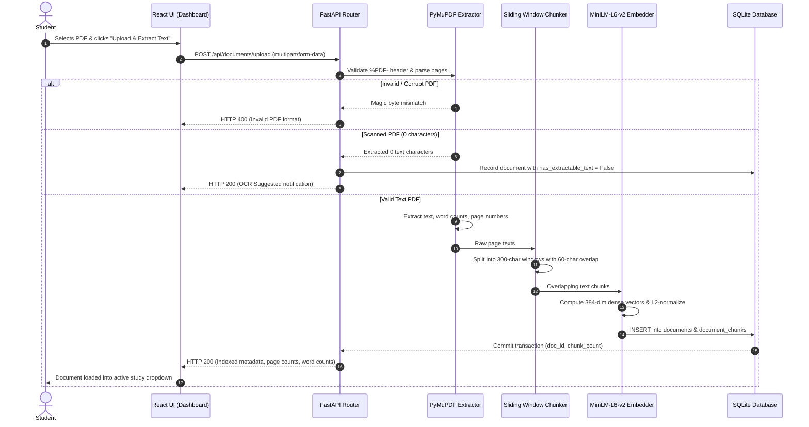
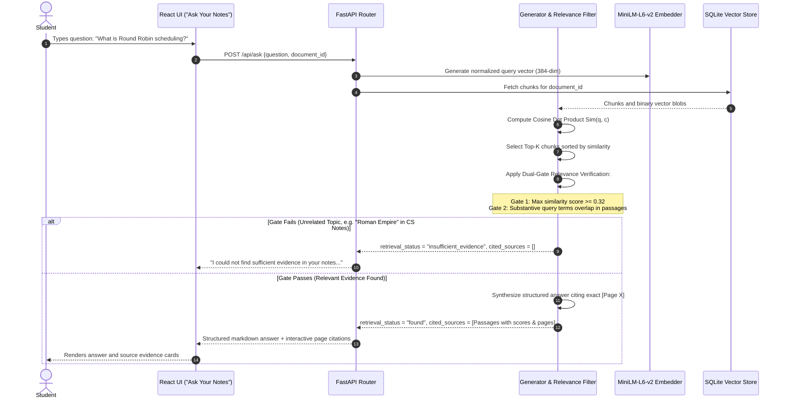
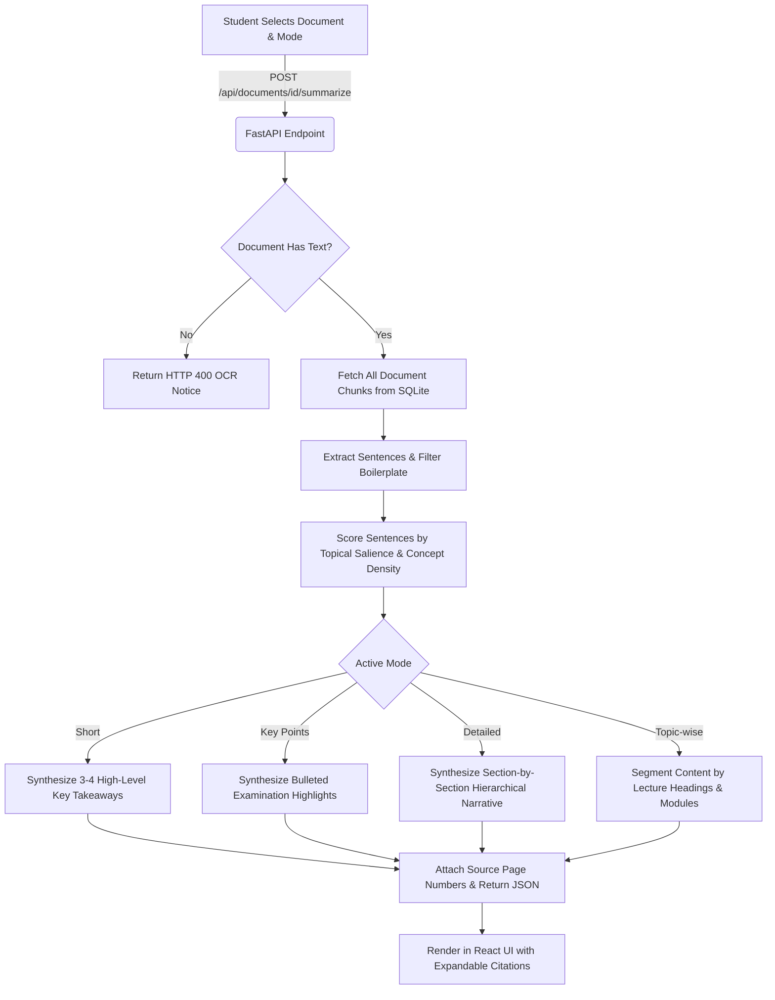
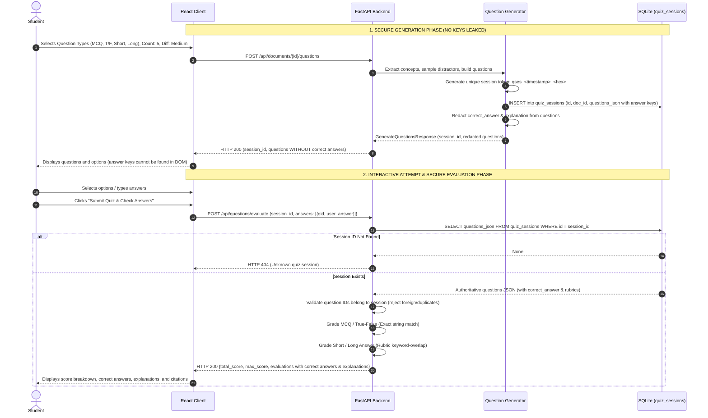
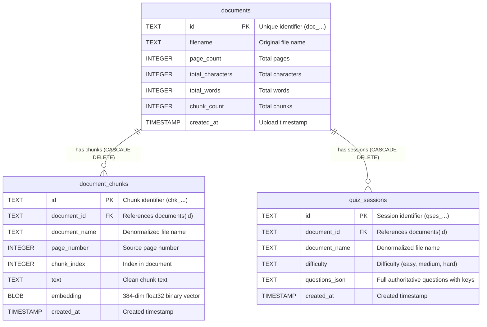

# StudySphere AI — System Architecture & Workflow Specifications

This document outlines the detailed system architecture, pipeline flowcharts, and component interaction models for **StudySphere AI**.

---

## 1. High-Level System Architecture Diagram

```mermaid
graph TD
    subgraph Client ["Frontend Presentation Layer (React 19 + TypeScript)"]
        UI["Web UI (Dashboard, Notes Q&A, Summarizer, Quizzes)"]
        API_CLIENT["Typed API Client (src/lib/api.ts)"]
        UI <--> API_CLIENT
    end

    subgraph Server ["API & Gateway Layer (FastAPI)"]
        ROUTER["FastAPI Router (app/main.py)"]
        P_SCHEMA["Pydantic Schemas & Validators (app/schemas.py)"]
        API_CLIENT <-->|HTTP / REST JSON| ROUTER
        ROUTER --- P_SCHEMA
    end

    subgraph Ingestion ["Ingestion & Preprocessing Pipeline"]
        PDF_PARSER["PDF Text Extractor (PyMuPDF)"]
        CHUNKER["Overlapping Sliding Window Chunker (app/rag/chunker.py)"]
        EMBED["SentenceTransformer: all-MiniLM-L6-v2 (app/rag/embeddings.py)"]
        
        ROUTER -->|Upload PDF| PDF_PARSER
        PDF_PARSER -->|Pages & Metadata| CHUNKER
        CHUNKER -->|Overlapping Text Chunks| EMBED
    end

    subgraph Storage ["Persistence Layer (SQLite - backend/data/studysphere.db)"]
        DB_DOCS[("documents Table")]
        DB_CHUNKS[("document_chunks Table: Text & Vector Blobs")]
        DB_QUIZ[("quiz_sessions Table: Authoritative Answer Keys")]
        
        PDF_PARSER -->|Document Metadata| DB_DOCS
        EMBED -->|Serialized Embeddings & Chunks| DB_CHUNKS
    end

    subgraph RAG_Engine ["RAG Q&A Pipeline (app/rag/generator.py)"]
        Q_EMBED["Query Embedding (all-MiniLM-L6-v2)"]
        COS_SEARCH["Cosine Similarity Vector Dot Product"]
        DUAL_GATE["Dual-Gate Relevance Filter (Threshold >= 0.32 & Term Coverage)"]
        SYNTH["Extractive Grounded Synthesizer"]

        ROUTER -->|Ask Question| Q_EMBED
        Q_EMBED --> COS_SEARCH
        DB_CHUNKS -.->|Candidate Vectors| COS_SEARCH
        COS_SEARCH --> DUAL_GATE
        DUAL_GATE -->|Pass: Relevant Chunks| SYNTH
        DUAL_GATE -->|Fail: Insufficient Evidence| ROUTER
        SYNTH -->|Grounded Answer + Page Citations| ROUTER
    end

    subgraph Summarizer_Branch ["Summarizer Pipeline (app/rag/summarizer.py)"]
        SUM_ENGINE["Extractive Sentence Saliency Ranker"]
        SUM_MODES["Mode Formatter: Short | Key Points | Detailed | Topic-wise"]

        ROUTER -->|Summarize Request| SUM_ENGINE
        DB_CHUNKS -.->|Document Text| SUM_ENGINE
        SUM_ENGINE --> SUM_MODES
        SUM_MODES -->|Structured Summary + Page Citations| ROUTER
    end

    subgraph Quiz_Gen_Branch ["Quiz Generation Pipeline (app/rag/question_generator.py)"]
        CONCEPT_EXT["Concept Extractor (Regex & Pattern NLP)"]
        DISTRACTOR_SAMPLER["Distractor Sampler (In-Document Term Pool)"]
        SESSION_GEN["Session Token Generator (qses_...)"]
        KEY_REDACTOR["Answer-Key Redactor (Public Payload)"]

        ROUTER -->|Generate Questions Request| CONCEPT_EXT
        DB_CHUNKS -.->|Document Concepts| CONCEPT_EXT
        CONCEPT_EXT --> DISTRACTOR_SAMPLER
        DISTRACTOR_SAMPLER --> SESSION_GEN
        SESSION_GEN -->|Save Authoritative Answer Keys| DB_QUIZ
        SESSION_GEN --> KEY_REDACTOR
        KEY_REDACTOR -->|Public Questions (Keys Redacted)| ROUTER
    end

    subgraph Quiz_Eval_Branch ["Authoritative Quiz Evaluation Pipeline"]
        EVAL_VALIDATOR["Request & Session Validator"]
        GRADING_ENGINE["Deterministic & Keyword-Overlap Grader"]

        ROUTER -->|Submit Student Answers + Session ID| EVAL_VALIDATOR
        DB_QUIZ -.->|Fetch Authoritative Answer Keys| EVAL_VALIDATOR
        EVAL_VALIDATOR -->|Authoritative Keys + User Answers| GRADING_ENGINE
        GRADING_ENGINE -->|Score + Feedback + Revealed Keys| ROUTER
    end
```

---

## 2. Ingestion & Indexing Pipeline Flow

The ingestion pipeline converts raw uploaded PDF documents into searchable semantic vector embeddings:



---

## 3. RAG Q&A Pipeline Flow

The Retrieval-Augmented Generation pipeline answers student queries grounded in source notes:



---

## 4. Multi-Mode Summarizer Pipeline Flow



---

## 5. Secure Revision Quiz Generation & Evaluation Flow

This diagram illustrates how answer keys are isolated from the frontend and evaluated server-side:



---

## 6. Entity Relationship Diagram (ERD)


